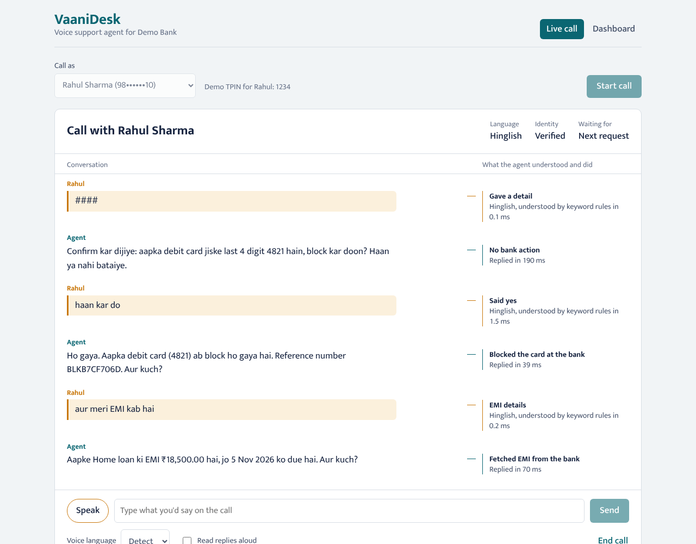
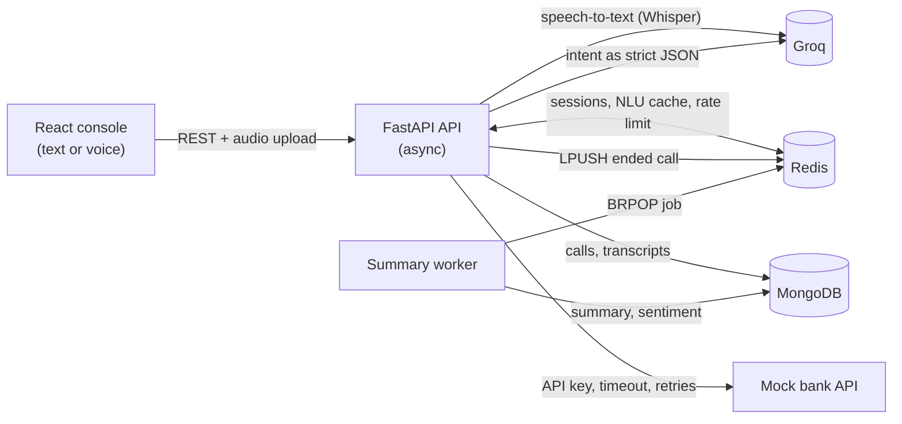

# VaaniDesk

A multilingual voice support agent for banking. A customer calls in and speaks English, Hindi or Hinglish ("mera debit card kho gaya hai"). VaaniDesk transcribes the voice, works out what they want, verifies their identity, calls the bank's API to do it, replies in the same language, and writes a post-call summary for the quality team.

Built with **FastAPI (async Python), MongoDB, Redis, React, Groq (Whisper + an open LLM)**, with a mock core-banking API standing in for a real bank.



## What it does

| Customer says | VaaniDesk does |
|---|---|
| "mera balance batao" | Asks for the TPIN, verifies it with the bank, reads out the balance in Hinglish |
| "I lost my wallet with my credit card in it" | Verifies identity, reads back the card ending, blocks it **only after an explicit yes**, gives a reference number |
| "मेरी ईएमआई कितनी है" | Replies in Hindi with the EMI amount and due date |
| "kisi agent se baat karao", or 3 wrong TPINs, or 3 turns it can't understand | Hands the call to a human |
| hangs up | A background worker writes a summary, sentiment and outcome to MongoDB for the dashboard |


## Architecture



### What happens on one customer turn

1. **Voice to text.** The audio goes to Whisper (`whisper-large-v3-turbo` on Groq). A short prompt biases it towards banking words like EMI, TPIN, haan and nahi.
2. **Protect the PIN.** A regex pulls out the 4-digit TPIN (digits, "1 2 3 4", "ek do teen char" or Devanagari digits) and **masks every number** before anything else sees the text. The PIN never reaches the LLM, the cache, the database or the API response.
3. **Detect the language** locally: Devanagari means Hindi, words like *mera, hai, kitna* mean Hinglish. Short replies like "yes" keep the call's current language.
4. **Understand the intent.** Check the Redis cache for this exact phrase first. Otherwise ask the LLM (`openai/gpt-oss-20b`) for strict JSON validated by a schema. If the LLM is slow, down or returns something invalid, fall back to keyword rules, so the call never breaks.
5. **Decide and act.** A small state machine in `agent.py` applies the guardrails and calls the bank API.
6. **Reply.** Fill a reply template in the customer's language with real numbers from the bank. The LLM never writes the reply, so it can't invent a balance or a due date.
7. **Log.** Save both turns to MongoDB (PIN masked) with the latency of each step, and save the session to Redis with a 30-minute idle expiry.

## Design decisions

- **The LLM understands, the code decides.** The LLM only classifies the intent. Identity checks, which bank call to make and what to say are deterministic code, which makes the agent predictable and testable.
- **Guardrails in code, not in the prompt:** no account data before the TPIN check; 3 wrong TPINs and you're handed to a human; blocking a card needs an explicit yes after the card is read back; 3 unclear turns in a row go to a human; if the bank is down, say so instead of guessing.
- **Personal data:** TPINs are masked before the LLM and before storage. Only the last 4 digits of the phone number are stored.
- **Integration done safely:** the bank client sends an API key, uses a 3-second timeout, and retries timeouts and 5xx errors with backoff (0.2s, 0.4s). It does not retry real answers like 404 "no loan". If a retry of "block card" finds the card already blocked (409), the agent treats it as done instead of failing.
- **Redis does five jobs:** live session state with a TTL, the NLU cache for repeated phrases, per-IP rate limiting, the job queue for summaries, and a 30-second cache for dashboard stats.
- **Slow work happens off the call.** Summaries run in a separate worker process fed by a Redis queue, so the customer never waits for them. Run more workers to process more calls.

## Run it

### With Docker (everything in one command)

```bash
cp backend/.env.example backend/.env     # optional: add GROQ_API_KEY for the LLM and voice
docker compose up --build
```

Open **http://localhost:5173** for the app and **http://localhost:8000/docs** for the interactive API docs.

### Without Docker

You need Python 3.11+, Node 20+, and MongoDB and Redis running locally.

```bash
# terminal 1: mock bank
cd backend
pip install -r requirements-dev.txt
cp .env.example .env                     # add your GROQ_API_KEY
uvicorn bank_service.main:app --port 8001

# terminal 2: API
cd backend && uvicorn app.main:app --port 8000 --reload

# terminal 3: summary worker
cd backend && python -m app.worker

# terminal 4: frontend
cd frontend && npm install && npm run dev
```

Without a Groq key everything still runs: keyword rules handle understanding and the voice button is disabled. Get a free key at console.groq.com.

### Demo customers

| Customer | Phone | TPIN | Has |
|---|---|---|---|
| Rahul Sharma | 9876543210 | 1234 | debit + credit card, home loan |
| Priya Nair | 9123456780 | 4321 | debit card only, no loan |
| Amit Verma | 9988776655 | 2580 | debit + credit card, personal loan |
| Sunita Devi | 9000012345 | 7890 | debit card, two-wheeler loan |

Set `BANK_FAILURE_RATE=0.3` on the bank service to watch the retries, and the "bank is not responding" reply, in action.

## API

| Method | Path | What it does |
|---|---|---|
| POST | `/calls` | Start a call from a phone number; returns the greeting |
| POST | `/calls/{id}/turns` | Customer says something (text) |
| POST | `/calls/{id}/audio` | Customer says something (voice note, multipart) |
| POST | `/calls/{id}/end` | Hang up and queue the summary |
| GET | `/calls`, `/calls/{id}` | Call history with masked transcripts and summaries |
| GET | `/stats` | Resolution rate, transfers, latency p50/p95, intents, languages, sentiment |
| GET | `/health` | Checks MongoDB and Redis |

## Tests and evaluation

```bash
cd backend
pytest                                   # 37 tests, no MongoDB/Redis/API key needed
python -m eval.run_eval                  # intent accuracy with keyword rules
python -m eval.run_eval --provider llm   # intent accuracy with the LLM (needs GROQ_API_KEY)
```

The tests run fully in memory (mongomock-motor, fakeredis, and the mock bank through httpx's ASGI transport). They cover TPIN masking, the LLM-to-rules fallback, every guardrail, bank outages, rate limiting, voice upload and the full call-to-summary path.

`eval/utterances.jsonl` has 50 labelled utterances (28 English, 15 Hinglish, 7 Hindi), including indirect ones like *"someone made a payment from my card that I didn't do"*.

| Understanding by | Intent accuracy | Card type | Notes |
|---|---|---|---|
| Keyword rules | 44/50 (88%) | 7/7 | Misses all 6 indirect phrasings |
| LLM (`gpt-oss-20b`) | run `--provider llm` | | Fill in after running |

The keyword rules and the eval set were written by the same person, so the rules score is optimistic. The 6 misses are exactly the cases the LLM is there for.

## Project structure

```
backend/
  app/
    main.py         FastAPI routes; one turn = understand -> decide -> reply -> log
    nlu.py          TPIN extraction and masking, language detection, LLM + cache + keyword fallback
    agent.py        dialogue state machine and guardrails
    replies.py      reply templates in English, Hindi and Hinglish; Indian number format
    bank_client.py  async bank API client with timeout and retries
    stt.py          Whisper speech-to-text
    summary.py      post-call summary (LLM, with rule fallback)
    worker.py       Redis queue consumer
    storage.py      MongoDB + Redis helpers (sessions, rate limit)
    prompts.py      all LLM prompts and JSON schemas
    config.py       settings from environment variables
  bank_service/     mock core-banking API (separate service)
  tests/            pytest suite
  eval/             labelled utterances + accuracy script
frontend/           React (Vite): live call console + dashboard
docker-compose.yml  mongo, redis, bank, api, worker, frontend
```

## Limitations and next steps

- Voice is push-to-talk (record, then send). A real phone agent streams audio both ways; the next step is a WebSocket or LiveKit/Pipecat pipeline with streaming ASR.
- Spoken replies use the browser's built-in voices ("Read replies aloud"), not a production TTS model.
- The mock bank keeps data in memory and resets on restart.
- Motor, the async MongoDB driver used here, is in maintenance mode; MongoDB recommends PyMongo's native async API for new code. Switching touches only `storage.py` and the aggregation calls in `main.py`.
- The eval set is small (50 utterances). Real call transcripts would give a much better picture.
